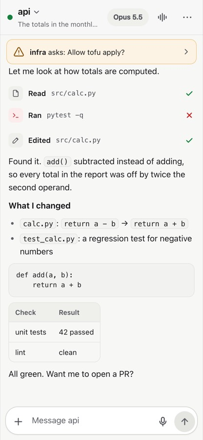
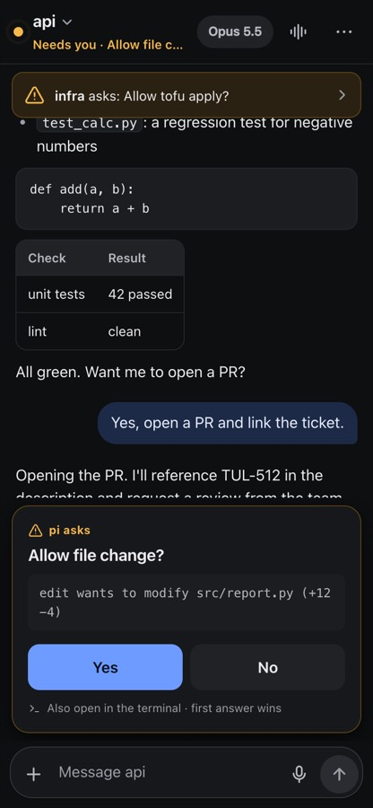
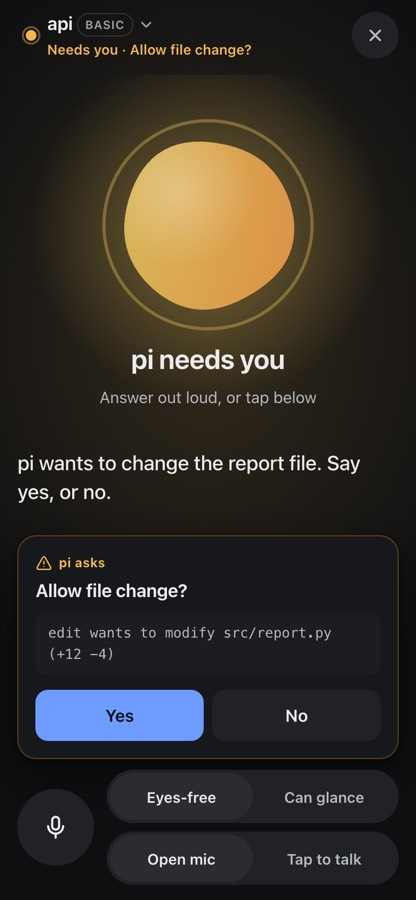

# pi-mobile

Your [pi](https://github.com/earendil-works/pi) sessions, on your phone. Run `/remote` once, scan the QR code, and every pi session on your computer is in your pocket: follow the work live, answer pi's questions from the lock screen, steer it, or just talk to it when your hands are busy.

No server to install, no account, no third-party relay, no app store. It all runs inside pi, and everything between your phone and pi is end-to-end encrypted.

<p>



</p>

## What you get

- **Answer pi from your pocket.** When pi asks something, any extension's question included (permission gates, pickers, text input), your locked phone buzzes. Tap, answer, and pi carries on. The question stays open in the terminal too; whichever side answers first wins.
- **Every session, one pairing.** `/remote` shares every pi on the machine, running or started later. The list puts the session that needs you first, and a bar at the top tells you when another one is waiting.
- **Talk to it when you can't look.** Voice mode is a spoken conversation about the work: what pi did, why something failed, what's next. It speaks about behaviour and decisions, never file names or diffs, reads pi's questions aloud, and makes you name an irreversible action ("yes, push") before it happens.
- **Dictate prompts, get what you meant.** Speak in the terminal or on the phone; what lands in the editor is a clean prompt, with your self-corrections applied and spoken names matched to real ones in the repository.
- **Steer without breaking flow.** Follow streaming output and tool steps live, steer pi mid-run or queue a follow-up, stop it, switch model or thinking level, compact, attach a photo.
- **Quiet while you're at the desk.** If you've typed in any pi terminal on that machine in the last two minutes, the phone stays silent.
- **Nothing to run, nothing to trust.** No relay, server or account. A paired phone talks to pi directly over your Wi-Fi, Tailscale or your own HTTPS address, and every request and event is encrypted for that phone alone.

## Install

```bash
pi install npm:pi-mobile
```

From a checkout: `pi install /path/to/pi-mobile` (after `npm install`), or try it once with `pi -e ./src/index.ts --remote`.

## Use

In any pi session on your computer:

```
/remote
```

That's the setup. The first time it shows a QR code: scan it, the panel closes by itself, and the phone stays paired. From then on `/remote` shows which sessions are shared and the address to open on your phone. Add that page to your Home Screen.

```
/remote pair          pair another device
/remote off           stop sharing this session, or every session on the machine
/remote devices       paired devices; pick one to revoke
/remote settings      how phones reach this computer, HTTPS address, port
```

`pi --remote` shares a single session without sharing the whole machine.

On the phone:

- Sessions are sorted by who needs you: asking a question, then working, then idle, each with its task and latest reply.
- The header says what the open session is doing ("Working · 0:42", "Needs you · Allow file change?").
- Tool calls are single rows (Read, Ran, Edited…); tap one for its output. Failures open with their error; edits show a diff.
- Only the session on screen streams its output, so ten busy sessions cost little battery or data.
- What you send from the phone is echoed in the terminal as `📱 <device>: …`.

### Lock-screen notifications and HTTPS

Browsers only allow notifications and the microphone on HTTPS pages. Put an HTTPS address in front of pi-mobile and tell it:

```bash
tailscale serve --bg 7878          # private to your tailnet
# then in pi: /remote settings → HTTPS address → https://<machine>.<tailnet>.ts.net
```

Pair through that address; the app offers to turn notifications on (also under **⋯**). On iPhone, add the page to the Home Screen first (iOS 16.4+). The "cloudflared" option in `/remote settings` gives HTTPS too, but its address changes when pi-mobile restarts.

## Voice

Design notes, research and verification: [docs/voice.md](docs/voice.md).

### Dictation: speak instead of typing

In the terminal press **alt+m** (or `/voice`), talk, then press **Enter**. On the phone, **hold the mic** in the composer and let go, or tap to start and tap ✓.

What lands in the editor is the message you meant, not a transcript: corrections applied ("null, no wait, undefined" → `undefined`), fillers gone, several asks turned into a list, and spoken names matched to real ones ("get user by ID in off dot ts" → `getUserById` in `src/auth.ts`). Anything ambiguous is listed as *Unclear* instead of guessed. You review it and send.

- **Edit by voice.** With text in the editor, "make that a list" or "drop the second point" edits it. Names you correct are remembered.
- **On-device recognition on a Mac.** On macOS 26 it uses Apple's SpeechAnalyzer: free, private, with live text while you talk (a small Swift helper compiles on first use; needs the Xcode command-line tools). Elsewhere, set `OPENAI_API_KEY` for `gpt-4o-transcribe`.
- `/voice raw` (verbatim), `/voice undo`, `/voice send` (send right after), `/voice status`.

### Voice mode: a conversation when you can't look

Tap the **bars icon** in the phone's header. Talk; pi answers out loud. On the computer itself, open `http://127.0.0.1:7878` and use its microphone and speakers.

- **About intent, not code.** It talks like an engineer on a walk: behaviour, decisions, risks, what's left. The full written answer stays in the transcript for later.
- **Sounds for state, words for news.** A tone when it hears you, a soft tick while pi works, a chime when it's done or needs you. It speaks up for outcomes, questions, and significant actions that failed (deploys, pushes, deletes, production data).
- **Ask anything, any time.** "What's it doing?", "why did that fail?", "stop", "switch to the api session", "say that again". Talk over pi and it quiets at once; an "mm-hmm" or a cough doesn't cut it off.
- **Answer pi's questions by voice or with a tap.** Irreversible actions need the action named: "yes, push", not "yeah". If you just asked for exactly that, it says "Deploying to production, say stop to cancel" and goes ahead after four seconds unless you stop it.
- **pi knows you're listening.** While voice mode is on, the agent is told you can't read: outcome first, one clear question when it needs you.
- **Pick its voice.** Four voices (Marin, Coral, Cedar, Ash: two feminine, two masculine), each with its own delivery and pace and a sample to hear first. The voice changes how pi sounds, never what it says. It is set per phone, from the menu or voice mode.
- **Built for busy hands.** A screen-sized circle for push to talk in wind or traffic (hold while you talk, or tap to start and stop), the headset play/pause button as a tap where the phone allows it, and **Eyes-free / Can glance** to set how much it says.

It uses a realtime speech model (`gpt-realtime-2`) over WebRTC straight from the phone, opened by pi with your ChatGPT sign-in or `OPENAI_API_KEY`; no token or audio passes through your computer. Without realtime it falls back to basic voice: recognition on your computer, a spoken brief, and the phone's speech (or any OpenAI-compatible speech endpoint via `voice.ttsUrl`, such as a local Kokoro).

Limits: on the phone, voice needs the HTTPS address. On iPhone the microphone stops when the screen locks, so voice mode keeps the screen awake. Web apps can't use CarPlay; audio plays through the car as usual. Settings are in `~/.pi/agent/pi-mobile/config.json` under `"voice"`: `stt` (`auto`/`apple`/`openai`), `locale` (e.g. `"fi-FI"`), `model` (`provider/id` for dictation and spoken briefs), `realtime` (`auto`/`off`), `realtimeModel`, `realtimeVoice` (used until a phone picks a voice), `turnDetection` (`semantic`/`server`), `tts` (`auto`/`off`), `ttsUrl`, `ttsModel`, `ttsVoice` (likewise; kept for local servers other than Kokoro), `ttsKey`, `afterDictation` (`review`/`send`). `PI_MOBILE_MIC` picks the terminal's microphone.

## herdr (optional)

If you run pi inside [herdr](https://herdr.dev), pi-mobile adds two things; outside herdr they switch off:

- **herdr's sidebar shows pi's questions.** Any pi dialog marks the pane *blocked*, so herdr and your phone agree on who needs you.
- **Start sessions from the phone.** Sessions → **New session**: pick a folder and an optional first prompt. herdr opens a tab there, starts pi, and the phone opens the new session.

## A laptop and a cloud box

pi-mobile runs wherever pi runs. A cloud box keeps working while your laptop sleeps, so it suits sessions you steer from the phone. Run pi there (inside herdr or tmux so it survives your SSH disconnects), install Tailscale on the box and your phone, and run `/remote`. pi-mobile only ever listens on loopback, private LAN and Tailscale addresses, never on a public IP, so the box's public interface stays closed. Each machine is paired separately for now; one list across machines is planned ([design](designs/multi-machine.md)).

## Security

- **Pairing.** `/remote` creates a single-use key valid for 10 minutes, carried in the QR URL's `#fragment`, which browsers never send to a server. The phone uses it to receive its own long-lived device key.
- **Transport.** Every request and event is sealed with the device's key (NaCl secretbox). Requests carry a timestamp and nonce, and replays are rejected. There are no bearer tokens or cookies to steal; Wi-Fi, Tailscale or a tunnel sees only ciphertext.
- **Devices.** Every paired device has full control, so pair only your own. Each can be revoked on its own (`/remote devices`, or from the phone).
- **Notifications.** Encrypted to your browser (RFC 8291), so the push service can't read them.
- **Local link.** pi processes join over loopback with a secret in `~/.pi/agent/pi-mobile/` (mode 0600).
- **Caveat.** On plain HTTP the web app itself isn't integrity-protected: an *active* attacker on your network could serve a modified app. On untrusted networks use the HTTPS address. A paired full-control device can do anything pi can, so revoke lost phones.

## How it works

```
 phone ──sealed HTTP + SSE──▶ hub (inside one pi) ◀──loopback link── other pi processes
```

- **One hub per machine.** Whichever pi binds the port hosts it; the others link to it. If that pi exits, another takes over within a second and the phone reconnects to the same address.
- **Nothing lost on reconnect.** Events carry sequence numbers and a replay buffer, so a phone that drops off catches up exactly.
- **Dialogs from any extension.** pi gives every extension the same `ctx.ui`, so wrapping `select`, `confirm` and `input` covers them all; whichever side loses is dismissed.

## Compared with other pi remotes (October 2026)

| | pi-mobile | [remote-pi](https://www.npmjs.com/package/@hk_net/remote-pi) | [@mipsel64/pi-remote-control](https://www.npmjs.com/package/@mipsel64/pi-remote-control) | [@pixu1980/pi-remote](https://www.npmjs.com/package/@pixu1980/pi-remote) | [pi-remote-control](https://www.npmjs.com/package/pi-remote-control) (Pi Relay) |
|---|---|---|---|---|---|
| Extra infrastructure | none | relay + native app | `prc` server binary + password | relay (third-party by default) + hosted PWA | daemon + iOS app + push gateway |
| Content visible to the relay or server operator | no (end-to-end encrypted) | yes, per its docs | runs on your machine | relay, unless self-hosted | not stated |
| Answer any extension's dialogs from the phone | **yes** | no | notifies only | pi-ask questions | not stated |
| Every pi on the machine, one pairing | yes | yes (agent mesh) | yes (central server) | per-directory room | per session toggle |
| Lock-screen notifications | Web Push (HTTPS) | native app | Web Push (HTTPS) | Web Push | APNs via a gateway |

The others have things this doesn't: native apps (remote-pi, Pi Relay), an agent-to-agent mesh across machines (remote-pi), and transcripts of sessions that have since closed (mipsel64).

## Development

```bash
npm install
npm test            # crypto, Web Push, hub, voice and the extension against a fake pi
npm run typecheck
npm run ui          # a hub with scripted sessions for working on the phone app
```

Before changing the phone app, read [docs/ui.md](docs/ui.md) and [docs/design-principles.md](docs/design-principles.md).

## License

[MIT](LICENSE)
