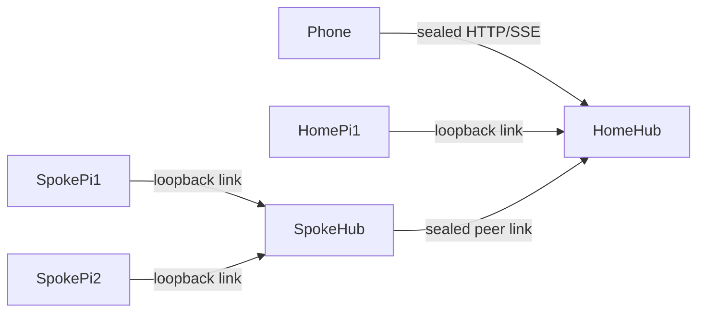

# Multi-machine sessions — Design

**Spec:** `specs/multi-machine.md` · **Frame:** no ADRs or `AGENTS.md`; the de-facto module structure of `src/` (crypto/store = pure + persistence, `protocol.ts` = wire shapes, `hub.ts` = per-machine server, `link.ts`/`bridge.ts` = per-pi side, `index.ts` = commands) and the "five composable pieces" in `README.md` (Channel, Mirror, Input, Dialogs, Attention). This feature extends **Channel** across machines; the other four pieces must work unchanged over it.

## Context and goals

UC-1..7 ask for one labelled session list across a laptop and a cloud box. Each machine already runs a hub that every local pi links to over loopback (`src/link.ts`, `src/hub.ts`), and the phone talks only to a hub. The design makes one hub the **home** and lets other machines' hubs (**spokes**) link to it, so the phone keeps one pairing, one URL and one push subscription. INV-1 (E2E on every hop) and INV-3 (single machine unchanged) constrain everything.

## Non-goals

- Phone-side merging of several homes: storage is per origin, and push keys are per hub (see D1).
- Spoke↔spoke links or multi-level trees: a star is enough for laptop + box, and a tree would need loop prevention for no benefit.
- Forwarding only the focused session's detail events from spoke to home: inter-machine bandwidth is not the constraint; revisit if a spoke has many busy agents.
- Showing the transcripts of offline machines: there is nothing live to show, and stale data misleads (D6).

## Components

| Component           | Responsibility                                                                                                                                                                                                   | Placement   | Depends on                 | Interface                                                                          | Files                                               |
| ------------------- | ---------------------------------------------------------------------------------------------------------------------------------------------------------------------------------------------------------------- | ----------- | -------------------------- | ---------------------------------------------------------------------------------- | --------------------------------------------------- |
| SealedChannel       | `Channel` whose every line is a secretbox frame with counter nonces; the transport sees only ciphertext                                                                                                          | shared      | `crypto.ts`, `channel.ts`  | `sealChannel(ch: Duplex, key, side: "home"\|"spoke"): Channel`                     | `src/channel.ts` (codec option), `src/crypto.ts`    |
| MachineIdentity     | Stable machine id and editable display name                                                                                                                                                                      | persistence | `store.ts`                 | `machine(): { id: string; name: string }`, stored in `machine.json`                | `src/store.ts`                                      |
| PeerAcceptor (home) | Accepts spoke upgrades (`pi-mobile-peer`), authenticates a `machine`-role device, registers the spoke's agents, routes requests to them, and forwards their events, attention and presence                       | hub         | SealedChannel, DeviceStore | HTTP upgrade `pi-mobile-peer`; agent registry entries `{ via: "local" \| peerId }` | `src/peer.ts` (`acceptPeer`), hooks in `src/hub.ts` |
| Upstream (spoke)    | While this process hosts the spoke's hub and `config.home` is set, keeps one sealed link to the home: announces local agents, mirrors their events, forwards attention and presence, and answers routed requests | hub         | SealedChannel, Hub         | `class Upstream { start(); stop(); state }`                                        | `src/peer.ts`                                       |
| AgentRegistry       | One routing table per hub: agent id → owner (local channel or peer) plus `AgentInfo` with `machine`                                                                                                              | hub         | —                          | `register`, `unregister(owner)`, `route(agent)`                                    | `src/hub.ts` (refactor of `agents` map)             |
| MachineCommands     | `/remote pair machine` (home), `/remote join <link>` (spoke), machine name in `/remote settings`, machines in `/remote devices` and the overview                                                                 | commands    | Hub requests               | slash subcommands                                                                  | `src/index.ts`                                      |
| PhoneMachines       | Machine label per session, grouping and offline rows in the session sheet, machine picker in the new-session sheet; [NEW] in voice mode, sessions matched by machine and one speech machine per call (plan step 7)                                                                                               | web         | hub events                 | `hub` rpc returns `machines[]`; events `machine_up`, `machine_down`                | `web/app.js`, `web/app.css`, `web/voice.js`, `web/voice-core.js` |

## Spec traceability

| Spec element                   | Owning component                | Notes (what breaks if removed)                                                         |
| ------------------------------ | ------------------------------- | -------------------------------------------------------------------------------------- |
| UC-1 link a machine            | MachineCommands                 | No way to create the machine device and `config.home`                                  |
| UC-2 one labelled list         | AgentRegistry                   | Spoke agents have no `machine` label and no route                                      |
| UC-3 machines come and go      | PeerAcceptor                    | The phone never learns a machine dropped; its sessions vanish silently                 |
| UC-4 same controls everywhere  | AgentRegistry (`route`)         | Phone requests for spoke agents fail with "not connected"                              |
| UC-5 one attention channel     | Upstream                        | Spoke notifications and presence never reach the home's push                           |
| UC-6 start on a chosen machine | PhoneMachines                   | The spawn sheet cannot target a spoke                                                  |
| UC-7 unlink                    | PeerAcceptor                    | A revoked machine keeps streaming until a restart                                      |
| INV-1 E2E every hop            | SealedChannel                   | Spoke traffic is plaintext on the LAN or tailnet                                       |
| INV-2 no lateral control       | PeerAcceptor                    | A compromised laptop could drive the box's agents                                      |
| INV-3 single machine unchanged | Upstream                        | Without `config.home`, Upstream never starts and nothing else changes                  |
| INV-4 unambiguous identity     | MachineIdentity + AgentRegistry | Same-named machines or colliding agent ids misroute                                    |
| NFR-1 back within 10 s         | Upstream                        | Reconnect backoff capped at 5 s, matching `HubLink`                                    |
| NFR-3 failover both sides      | Upstream                        | Lives in the hub process, configured from shared `config.json`, so a new host re-links |
| NFR-2 no new infrastructure | Upstream | Dial-out from spoke means no public address, relay or account; removing it forces inbound reachability |
| NFR-4 herdr optional | PhoneMachines | Machine picker lists only machines with a herdr agent; without herdr the sheet simply has no target |

## Data flow

**Link (UC-1).** On the home, `/remote pair machine` → `Hub.createPairing("machine")` → link printed. On the spoke, `/remote join <link>` → spoke POSTs `/api/pair` (same sealed pairing as phones, role `machine`) → stores `config.home = { url, device, key }` → its hub starts `Upstream`.

**Steady state.**

1. Upstream dials `home/…` with `Upgrade: pi-mobile-peer` and a sealed hello `{ t, machine: { id, name }, protocol }`. The home checks that the device exists, has role `machine`, and passes the replay check.
1. Upstream sends `agents` (all local `AgentInfo`) and then forwards each local `HubEvent` as-is. The home re-publishes them with its own `seq` and adds `machine` to `info`.
1. Phone → home `agent { agent, m, p }` → `AgentRegistry.route(agent)` → if owner is a peer: sealed `req` over the peer link → Upstream → local agent channel → reply back the same way.
1. Spoke `attention` / `presence` → home `attention()` / `lastPresence` (presence is global, D5).
1. The peer link drops → home emits `machine_down { machine }` and `gone` for each of its agents. On reconnect, step 2 repeats, the home emits `machine_up` plus `reset` per agent, and a phone viewing one reloads its snapshot.

## State ownership

| State                               | Owner                                         | Mutated by                         | Source of truth                             |
| ----------------------------------- | --------------------------------------------- | ---------------------------------- | ------------------------------------------- |
| `config.home` (url, device id, key) | spoke `config.json`                           | MachineCommands (`join`, settings) | spoke `config.json`                         |
| machine id and name                 | `machine.json` per machine                    | MachineIdentity (settings rename)  | that machine                                |
| machine devices (role `machine`)    | home `devices.json`                           | pairing, `/remote devices` revoke  | home `devices.json`                         |
| spoke agents seen by home           | home AgentRegistry                            | PeerAcceptor only                  | spoke hub (re-announced on every connect)   |
| offline machines list               | home Hub (in memory: last name, `lastSeenAt`) | PeerAcceptor                       | home memory; persisted copy not needed (D6) |
| presence timestamp                  | home Hub                                      | local bridges + PeerAcceptor       | home memory                                 |

## Decisions

### D1: Federate hubs around a home instead of merging on the phone

- **Decision:** spokes link to one home hub; the phone keeps a single pairing and origin.
- **Driver:** UC-2, UC-5, NFR-2.
- **Alternatives:** phone pairs each machine and merges client-side — rejected because pairing keys live in per-origin `localStorage`, an HTTPS app cannot call plain-HTTP hubs (mixed content), and a push subscription is bound to one VAPID key, so every machine would need its own subscription and a second home-screen app. The phone would also have to reach every machine, while federation only needs spoke → home.
- **Reversibility:** costly (protocol and pairing roles).
- **Validated by:** `test/peer.test.ts`: one phone paired only with the home sees and controls a spoke agent, and receives its attention push through the injected `sendPush`.

### D2: The spoke dials the home; the home is chosen explicitly

- **Decision:** `config.home` on the spoke; the home stores nothing until a spoke connects.
- **Driver:** UC-3 (the laptop sleeps and changes networks; the box is always on), NFR-2.
- **Alternatives:** the home dials spokes — rejected because laptops sit behind NAT and change addresses. Automatic discovery over the tailnet — rejected because it needs the Tailscale API and an account token (NFR-2).
- **Reversibility:** cheap.
- **Validated by:** peer test where the spoke restarts on a new port and the home sees it again (NFR-1 timing assertion ≤ 10 s).

### D3: A spoke is a paired device with role `machine`

- **Decision:** reuse pairing, `devices.json`, revoke and listing; add role `machine`, which is allowed only on the peer endpoint, never on `/api/rpc` or `/api/stream`.
- **Driver:** UC-1, UC-7, INV-2.
- **Alternatives:** a separate machine trust store — rejected because it duplicates pairing, revoke and UI for no extra safety.
- **Reversibility:** cheap.
- **Validated by:** a test that a `machine` key gets 401 from `/api/rpc` and `/api/stream`, and a peer request to call another machine's agent is rejected.

### D4: Sealed frames over an HTTP upgrade for hub↔hub

- **Decision:** `Upgrade: pi-mobile-peer`, then `Channel` framing where each line is `seal(key, json)` with a per-direction counter nonce (no timestamps, so no clock-skew window).
- **Driver:** INV-1; bidirectional requests in both directions (UC-4).
- **Alternatives:** the phone's SSE + POST pattern — rejected because the home must push requests to the spoke and the spoke streams events back, which needs two long-lived HTTP flows and per-request crypto. A WebSocket library — rejected to keep the zero-dependency transport.
- **Reversibility:** cheap.
- **Validated by:** a channel test that tampered, reordered or replayed frames close the link; a peer test running through a plain TCP proxy that asserts no plaintext marker appears on the wire.

### D5: Presence is per owner, not per machine

- **Decision:** a keystroke at any machine's pi terminal holds all phone pushes.
- **Driver:** UC-5: one person, so being at any keyboard means not on the phone.
- **Alternatives:** per-machine presence — rejected because typing on the laptop while the box finishes would still buzz the phone in your pocket.
- **Reversibility:** cheap.
- **Validated by:** peer test: spoke presence followed by home attention → no `sendPush` call.

### D6: Offline machines show as a row, not as last-known sessions

- **Decision:** the home remembers machine name and `lastSeenAt` in memory and shows "laptop — offline since 21:40".
- **Driver:** UC-3.
- **Alternatives:** keep the last-known sessions greyed out — rejected because they can't be opened (no snapshot source) and their status is stale.
- **Reversibility:** cheap.
- **Validated by:** web E2E: kill the spoke and the phone shows the offline row within 5 s; restart it and the sessions are back.

### D7: A linked spoke stops pushing to its own subscribers

- **Decision:** with `config.home` set, the spoke forwards attention upstream and sends no pushes itself.
- **Driver:** UC-5: one notification per event.
- **Alternatives:** push both ways — rejected because a phone paired with both machines would get duplicates.
- **Reversibility:** cheap. **Decided 2026-10-10:** yes. Every session reaches the phone through the home, so a phone needs only the home's pairing; a linked machine's own notifications would only duplicate the home's.
- **Validated by:** peer test asserting the spoke's `sendPush` is never called while linked.

## Failure modes and cross-cutting concerns

| Scenario                                   | Behaviour                                                                                                                  | Owning component              |
| ------------------------------------------ | -------------------------------------------------------------------------------------------------------------------------- | ----------------------------- |
| Home unreachable                           | Upstream retries with backoff ≤ 5 s; the spoke stays a full hub for its own local phones                                   | Upstream                      |
| Spoke sleeps mid-request                   | Home rejects pending peer requests with "laptop is offline"; the phone shows the error                                     | PeerAcceptor                  |
| Home hub fails over to another pi          | Spokes reconnect to the same URL and port; the phone resyncs as today                                                      | Upstream                      |
| Spoke hub fails over                       | The new host reads `config.home` and dials; the home replaces the old peer link for the same machine id                    | Upstream, PeerAcceptor        |
| Machine device revoked                     | Home closes the peer link and answers future hellos with 403; the spoke footer shows "unlinked by home" and stops retrying | PeerAcceptor, Upstream        |
| Protocol mismatch                          | Home rejects the hello with both versions; the spoke shows the error in `/remote`                                          | PeerAcceptor                  |
| Two machines with the same name            | Labels get an id suffix on the phone; routing uses ids only (INV-4)                                                        | AgentRegistry                 |
| Spoke also configured as a home for others | Rejected at `join` time and on hello (star only, Non-goals)                                                                | MachineCommands, PeerAcceptor |
| Spoke forwards a peer's agents (loop)      | Upstream forwards only its local agents                                                                                    | Upstream                      |
| Version skew between hubs                  | Same `PROTOCOL` check as local links; message names both versions                                                          | PeerAcceptor                  |
| Observability                              | `/remote` overview lists machines with online state and last seen                                                          | MachineCommands               |

## Conformance rules (machine-checkable)

No conformance tool is configured in the repo; these are checked with `rg` in `test/conformance.test.ts`:

- `src/peer.ts` imports from `./channel.ts`, `./crypto.ts`, `./protocol.ts`, `./store.ts`, `./hub.ts` types only; nothing from `./bridge.ts`, `./index.ts`, `./voice/**`.
- `web/**` never references `pi-mobile-peer` (phones cannot use the peer endpoint).
- `src/hub.ts`: every `deviceCall` branch rejects `role === "machine"` (the test asserts a 401 or 403 for each rpc method with a machine key).
- Only `src/peer.ts` constructs `sealChannel(`.
