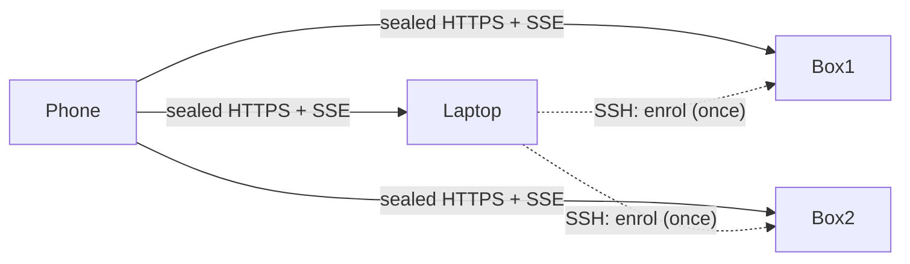

# Multi-machine sessions — Design

**Spec:** `specs/multi-machine.md` (v2) · **Status:** v2, 2026-10-10, supersedes the v1 "home hub" design (git history), which nothing implemented.

**Frame:** the de-facto module structure of `src/`:

| Module | Role |
|---|---|
| `crypto.ts`, `store.ts` | pure logic and persistence |
| `protocol.ts` | wire shapes |
| `hub.ts` | per-machine server |
| `link.ts`, `bridge.ts` | the per-pi side |
| `index.ts` | commands |
| `web/` | the phone, which owns its own state in `localStorage` |

UI rules come from `docs/ui.md` and `docs/design-principles.md`.

## First principles

1. **The phone is the only thing that is always with the owner**, and the only thing every session is for. So the phone holds the list of machines. Every machine is equal, and none relays for another. A relay would make one machine a single point of failure, and the owner's machines are exactly the kind that sleep (a laptop) or get deleted (boxes made for a week).
2. **Trust flows from a device you already trust.** Apple adds a device to iCloud Keychain this way: an existing member sponsors the new one, and the person approves on a device they hold ([Apple security guide](https://support.apple.com/guide/security/sec0a319b35f/web)). Signal's linking runs the other way: the trusted phone scans a code shown by the new device. Attackers have abused that, phishing people into scanning malicious codes ([MITRE T1676](https://attack.mitre.org/techniques/T1676)). So a machine is added from a trusted machine and approved on the phone; nothing is enrolled by scanning a code someone shows you.
3. **Use the channels that already authenticate.** pi creating a box from the laptop already has SSH to it. The phone already reaches every machine over Tailscale. pi-mobile adds no account, relay or server; it puts keys on top of those channels.
4. **Easy means nothing to do.** One decision on the phone ("Add box?"), never a code, a key or a URL. A deleted box goes away by itself. A sleeping laptop says so in words.

## Context

Today one origin (one machine's hub) serves the app, holds one device key and one push subscription, and shows that machine's sessions. v1 extended this into a star around a "home" machine. That fails the owner's setup:
- If the laptop is home, every box disappears from the phone whenever the lid closes.
- If a box is home, deleting it breaks everything.
- Moving home changes the web address, which on iPhone means re-adding the Home Screen app and re-subscribing to notifications ([push subscriptions are bound to an origin](https://documentation.onesignal.com/docs/en/web-push-setup-faq.md)).

v1 rejected merging on the phone for four reasons. Each one dissolves once machines are reached over Tailscale HTTPS:

| v1 objection | Why it no longer holds |
|---|---|
| Storage is per origin | One origin, the first machine, stores every machine's key |
| An HTTPS page can't call plain-HTTP hubs | Every added machine has a Tailscale HTTPS address |
| One push subscription per VAPID key | All machines share one VAPID key, so the one subscription works for all (D4) |
| The phone must reach every machine | Tailscale gives that by design |

## Goals

- **G1** Every session on every machine, in one list, with notifications, even when any one machine is asleep or gone.
- **G2** Adding a machine from a trusted one takes one command, or a request to pi, and one tap on the phone.
- **G3** No new infrastructure; a single machine stays exactly as today.

## Non-goals

| Non-goal | Why |
|---|---|
| A hosted app shell or a stable address independent of machines | A page served from our domain would be code everyone trusts with their keys, against "nothing to trust". Tailscale Services gives a stable name, but [hosts must be tagged devices](https://tailscale.com/docs/features/tailscale-services), and a personal laptop usually isn't. Kept as an optional later (D7) |
| Trusting machines because Tailscale says they're yours, with no enrolment | Boxes joined with auth keys are tag-owned, not user-owned, so identity lookups give a tag, not the owner ([whois patterns](https://packagist.org/packages/geocodio/laravel-tailscale-identity)); and anything that can join the tailnet would see sessions. Revisit only as an opt-in |
| Machine-to-machine links | Not needed for G1. Presence stays per machine (D6) |
| Provisioning boxes | pi or herdr does that; pi-mobile only adds a machine that exists |

## Components

| Component | Responsibility | Interface | Files |
|---|---|---|---|
| MachineIdentity | A stable machine id and an editable name per machine | `machine(): { id, name }` in `machine.json` | `src/store.ts` |
| Enrol (new machine side) | Without pi running: create device records (one per phone, with fresh keys), adopt the fleet's VAPID key and the phones' push subscriptions, and report the machine's HTTPS origin, setting up `tailscale serve` if allowed | `pi-mobile enrol` CLI: JSON on stdin and stdout, never secrets in argv | `src/cli.ts` (new, `bin` in `package.json`), `src/enrol.ts` (new) |
| Sponsor (trusted machine side) | `/remote add <ssh-host>`: run `enrol` on the host over SSH with the same pi-mobile version, then queue an offer for each phone paired here; `/remote remove <name>` queues a removal | slash subcommands plus headless `pi-mobile add <host>` / `remove <name>` for scripts and pi | `src/index.ts`, `src/sponsor.ts` (new) |
| Offers | Persist offers and removals per phone until delivered (7-day TTL); deliver over that phone's sealed event stream and as a push ("Add box?") | hub event `machine_offer { machine, origin, d, k, from }`, `machine_removed { machine }` | `src/hub.ts`, `src/store.ts`, `src/protocol.ts` |
| Hub CORS and CSP | Answer `/api/*` from the phone's app origin (sealed bodies, no credentials, so `Access-Control-Allow-Origin: *`); allow `connect-src` to `https://*.ts.net` plus configured HTTPS addresses | headers | `src/hub.ts` |
| Fleet (phone) | The machine list `{ id, name, origin, d, k, added, lastSeen }`, one connection per machine (sealed RPC and SSE), merging their `info`/`prompt` events into one session map keyed `machine/agent` and routing calls to the right machine. Migrates the old single device into the list | `fleet.call(key, m, p)`, `fleet.on(event)`, `fleet.add(offer)`, `fleet.remove(id)` | `web/fleet.js` (new, pure where possible), `web/app.js` |
| Machines UI (phone) | Offer sheet ("Add box?"); machine chip on sessions when there is more than one machine; offline rows; the Computers sheet (rename shown, remove, Add a computer by scan or paste); machine picker for new sessions | components per `docs/ui.md` | `web/app.js`, `web/app.css` |
| Shell cache (phone) | Cache the app shell in the service worker, so the app opens while the machine that served it sleeps | cache-first for shell files, network-first for `/api` | `web/sw.js` |
| Push fan-in | Every machine sends its own notifications with the shared VAPID key; the payload carries the machine; the tag is `pi-<machine>-<agent>` | `webpush.ts` unchanged; payload `{ machine, agent, title, body }` | `src/hub.ts`, `web/sw.js` |
| Voice across machines | Match sessions by machine; one speech machine per call; announce a machine that drops | as `plans/multi-machine.md` step 7 | `web/voice.js`, `web/voice-core.js`, `src/voice/realtime.ts` |



## Spec traceability

| Spec element | Owner | If removed |
|---|---|---|
| UC-1 first machine | (unchanged pairing) | — |
| UC-2 add from trusted | Sponsor + Enrol + Offers | No way to add a machine without a scan |
| UC-3 add without trusted path | Machines UI (scan/paste in the app) | A machine no other machine can reach can't be added |
| UC-4 one labelled list | Fleet | Sessions from several machines can't be shown together |
| UC-5 sleep and wake | Fleet (per-machine reconnect, offline state) | A sleeping machine's sessions vanish silently |
| UC-6 same controls | Fleet (`call` routing) | Calls go to the wrong machine |
| UC-7 notifications from all | Push fan-in | Only the first machine notifies |
| UC-8 start on chosen machine | Machines UI | New sessions only on one machine |
| UC-9 remove | Machines UI + Offers (`machine_removed`) + hub `revoke` | Deleted boxes linger; a removed machine keeps access |
| UC-10 voice | Voice across machines | Voice can't switch machines; speech fails on boxes without credentials |
| INV-1 E2E | Fleet (per-machine keys) | — |
| INV-2 no power over each other | Enrol (keys made per machine and per phone) | One machine's key would open another |
| INV-3 single machine unchanged | Fleet migration | Existing phones would need a re-scan |
| INV-4 consent | Offers + Machines UI (the phone asks) | A prompt-injected agent could silently enrol a hostile box |
| INV-5 no single point | Fleet + Shell cache + Push fan-in | The machine that served the app would gate everything |
| NFR-1 10 s | Fleet reconnect (backoff ≤ 5 s) | — |
| NFR-4 scriptable | Sponsor headless commands | pi couldn't add boxes it creates |

## Flows

**Add a machine from a trusted one (UC-2).**

```mermaid
sequenceDiagram
  participant O as Owner / pi
  participant L as Laptop (trusted)
  participant B as Box (new)
  participant P as Phone
  O->>L: /remote add box  (or pi-mobile add box)
  L->>B: ssh box npx -y pi-mobile@V enrol  (stdin: phones' subscriptions, fleet VAPID key)
  B-->>L: stdout: { machine, origin, devices: [{ phone, d, k }] }
  L->>P: machine_offer (sealed with that phone's laptop key) + push "Add box?"
  P->>O: sheet: "Add box? Added from laptop · box.tailnet.ts.net"  [Add] [Not now]
  P->>B: Add: hub, push (its subscription); box's sessions appear
  P->>B: Not now: revoke its own device on box
```

`enrol` checks or creates:
- `machine.json`;
- a device record per phone;
- the VAPID key (adopted, never overwriting a different one without `--force`);
- the subscriptions;
- `tailscale status --json` for the HTTPS name, and `tailscale serve --bg <port>`. If that needs permission, it fails with the exact command to run (`sudo tailscale set --operator=$USER`) and the admin toggle for HTTPS.

It works before any pi runs on the box; the box shows as offline until one does.

**Add without a trusted path (UC-3).** On the new machine, `/remote` shows its pairing QR code as today. On the phone, the in-app Add a computer either scans it or takes a pasted link (Universal Clipboard from a Mac makes paste effortless). The camera app's own QR scan never adds to the list, because it opens the page in Safari under the machine's own address.
- Scanning uses `BarcodeDetector` where available, otherwise a small vendored decoder. iOS Safari still has `BarcodeDetector` behind a flag ([caniuse](https://caniuse.com/mdn-api_barcodedetector)).
- The pairing creates the device as today, then `fleet.add`.

**Steady state.** The Fleet keeps one SSE stream per online machine and a `focus` on the machine of the session on screen. A machine's stream failing marks it offline after the existing 40 s stall rule, or at once on a connection error, and retries with 0.5–5 s backoff. Calls carry the machine id from the session key.

**Remove (UC-9).**
- From the phone: `revoke` its own device on that machine if reachable, then forget it.
- From a trusted machine: `/remote remove box` queues `machine_removed` to each phone, and the phone does the same.
- After a removal, the phone rotates the fleet VAPID key the next time it opens (re-subscribe, then `push` the new subscription and key to each remaining machine). A removed machine can no longer notify.

## State ownership

| State | Lives in | Mutated by | Source of truth |
|---|---|---|---|
| Machine list and keys | phone `localStorage` `pi-mobile-machines` (native: Keychain) | Fleet only | phone |
| Device records for a phone | each machine's `devices.json` | pairing, Enrol, `revoke` | that machine |
| Machine id and name | each machine's `machine.json` | MachineIdentity | that machine |
| Pending offers and removals | sponsor's `offers.json`, per phone | Sponsor (add), hub (delivered) | sponsor until delivered |
| Fleet VAPID key | every machine's `push.json`, the same pair | first machine; Enrol copies; the phone rotates | the phone's current subscription |
| Push subscription | every machine's `push.json` | phone `push` RPC to each machine | phone |
| Presence | each machine | local terminals | that machine (D6) |

## Decisions

### D1: The phone holds the machine list; machines are peers (supersedes v1 D1 "federate around a home")
- **Driver:** INV-5, UC-5, UC-7. The owner's laptop sleeps and boxes are deleted.
- **Alternatives:**
  - A home hub relaying for spokes (v1): rejected; any home is a single point of failure, and moving home changes the origin.
  - Home handoff when an always-on box appears: rejected; it still moves the origin and breaks again when that box is deleted.
- **Reversibility:** costly once phones store several machines.
- **Validated by:** `test/fleet.test.ts`: with three fake machines, one stopping marks only its sessions offline and calls to the others still succeed; a browser E2E with two fixture hubs on two ports.

### D2: Machines are added by a trusted machine over SSH and approved on the phone
- **Driver:** UC-2, NFR-3, NFR-4, INV-4.
- **Alternatives:**
  - A QR scan per machine: works (it is UC-3), but it puts work on the owner every week and is the phishable direction.
  - Trusting the tailnet with no enrolment: see non-goals.
  - The sponsor adding silently: rejected; a prompt-injected agent with a shell could enrol a hostile box that then phishes through "pi asks" cards. One tap names the box, where it was added from, and its address.
- **Reversibility:** cheap.
- **Validated by:**
  - `test/enrol.test.ts`: `enrol` on a temp `PI_CODING_AGENT_DIR` creates per-phone devices and adopts VAPID, with no secrets in argv.
  - A sponsor test with a fake `ssh` executable.
  - A phone test that an offer is never added without Add.

### D3: Each machine gets its own key per phone
- **Driver:** INV-2, UC-9.
- **Alternatives:** one fleet key shared by all machines: rejected; one compromised box would read every machine's traffic, and removing a machine would need rekeying everything.
- **Reversibility:** costly.
- **Validated by:** the enrol test asserts that keys differ per machine and per phone; revoking one leaves the others working.

### D4: One VAPID key shared by all machines; each machine sends its own notifications
- **Driver:** UC-7, INV-5.
- **How it works:** a push subscription is bound to one application server key, and any sender holding that key and the subscription can send ([RFC 8292](https://datatracker.ietf.org/doc/html/draft-ietf-webpush-vapid-04)).
- **Alternatives:**
  - Relaying notifications through one machine: a single point of failure.
  - Several service worker scopes, each with its own subscription: untested on iOS, and more for the owner to allow.
- **Cost:** a compromised machine could send notifications that look like another machine's. Mitigated by rotating the key on removal (Flows → Remove).
- **Reversibility:** cheap.
- **Validated by:** `test/webpush.test.ts`: two hubs with the same VAPID key produce valid authorizations for one subscription.

### D5: The first machine's origin stays the app's address; the service worker caches the shell
- **Driver:** INV-3, INV-5.
- **Alternatives:**
  - A hosted shell: a trust point, against the product.
  - A Tailscale Service name: needs tagged hosts (D7).
- **Risk:** iOS may evict the cache after weeks of non-use ([reports](https://bugs.webkit.org/show_bug.cgi?id=192166)); the app then needs the first machine awake once. If the first machine is retired, the owner re-adds the Home Screen app from another machine. That is rare, like a new phone. `[verify on device]` offline launch after a week unused.
- **Validated by:** a browser E2E: stop the origin hub, reload, the shell loads and other machines' sessions show.

### D6: Presence stays per machine
- **Driver:** "quiet while you're at the desk".
- **Why it's enough:** with herdr's remote mode, pi runs on the box, so typing into a box session counts on the box.
- **Accepted cost:** typing into a laptop-only session doesn't hold the box's notifications.
- **Alternative:** a presence mesh between machines: new links for a small gain. Revisit if notifications feel noisy.
- **Validated by:** existing presence tests per hub.

### D7 (later, optional): a stable app address
If the owner tags the boxes, `tailscale serve --service=svc:pi` on each box gives one name (`pi.<tailnet>.ts.net`) that survives any one box ([Tailscale Services](https://tailscale.com/blog/services-beta)). Not needed for G1–G3.

## Failure modes

| Situation | Behaviour |
|---|---|
| The machine that served the app is asleep | The shell loads from the cache; that machine shows offline; the others work |
| A box is deleted without `remove` | Offline since …; after 7 days offline, the Computers sheet offers Remove for it (never automatic) |
| SSH fails during `add` | Nothing is queued; the command prints the SSH error and the manual way (UC-3) |
| `tailscale serve` or HTTPS isn't set up on the box | `enrol` fails with the exact command or admin setting; nothing is created |
| The phone never opens the offer | It is delivered on next connect or as a push; it expires after 7 days; the box's unused device records are then revoked |
| Two machines share a name | The phone adds a short id suffix; routing uses ids only |
| Versions differ across machines | `hub` returns `protocol`; an incompatible machine shows "box needs a pi-mobile update" and is not used. `add` installs the sponsor's version |
| The key leaks from a box | `remove` revokes it there and rotates VAPID; other machines are unaffected (D3) |
| Machine names in public certificate logs | Tailscale HTTPS publishes `machine.tailnet.ts.net` in CT logs ([Tailscale](https://tailscale.com/docs/how-to/set-up-https-certificates)). The README says to name machines accordingly |
| Chrome on Android gating local-network requests | Phone and machines are all on `*.ts.net` (100.64/10). `[verify]` how Chrome's Local Network Access classifies that range ([Chrome](https://developer.chrome.com/blog/local-network-access)); fallback: `targetAddressSpace` on fetch |

## Conformance rules

- `web/fleet.js` has no DOM access and imports nothing; `node --test` loads it, like `voice-core.js`.
- Secrets never appear in a process argv: `test/enrol.test.ts` asserts the sponsor spawns `ssh` with keys only on stdin.
- `src/enrol.ts` and `src/cli.ts` import nothing from `src/bridge.ts`, `src/index.ts` or `src/voice/**`; `enrol` must run without pi.
- No machine-to-machine network code. `rg "pi-mobile-peer" src` stays empty.
